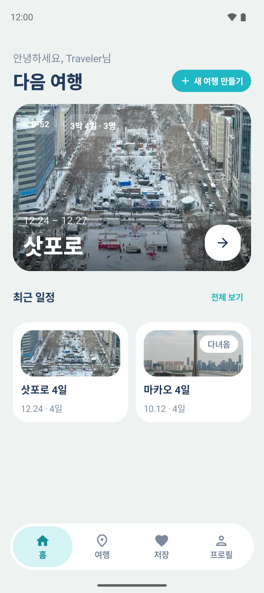
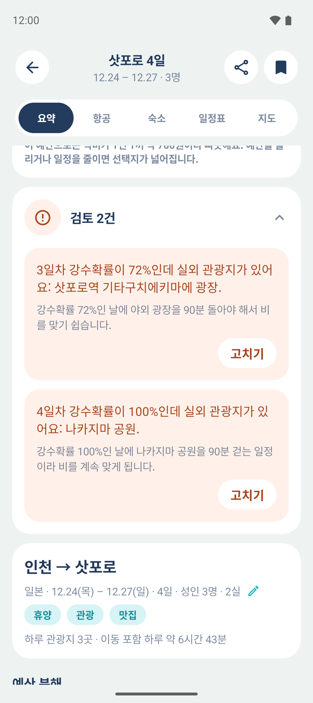
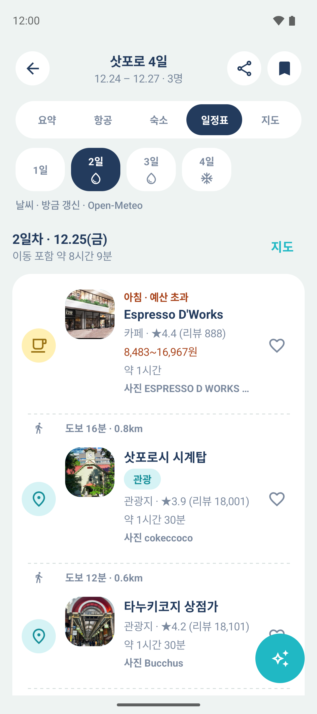
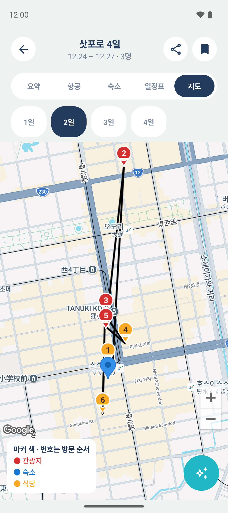
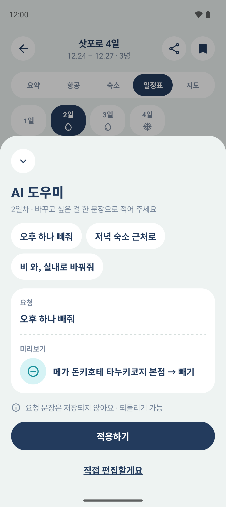
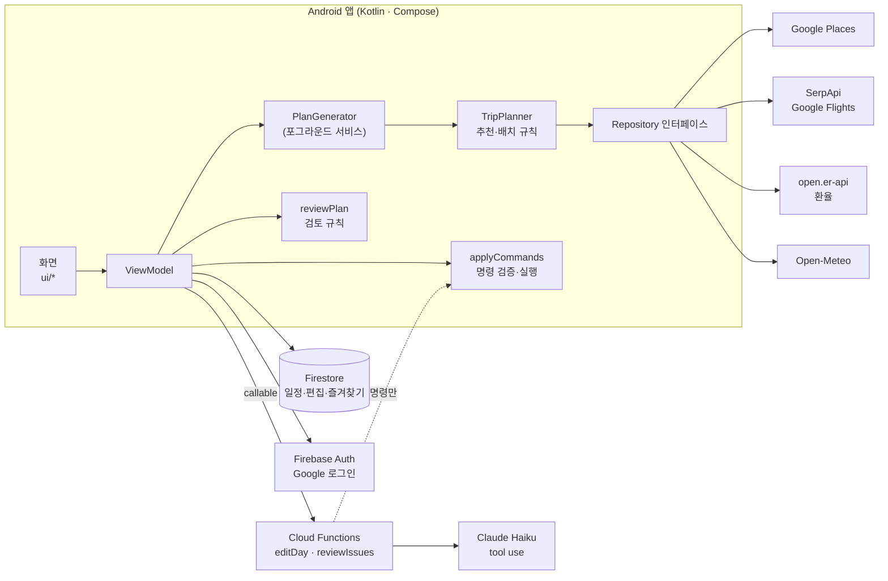

# Readytogo

**예산·날짜·목적지·여행 목적만 고르면 항공권, 숙소, 하루 동선, 식당까지 한 번에 짜 주는 해외여행 계획 앱** (Android)

> English summary is at the [bottom](#english-summary).

<!-- 데모: docs/demo.gif 를 넣은 뒤 아래 줄의 주석을 푼다

-->

| 로그인 | 홈 | 요약 + 일정 검토 |
|---|---|---|
|  |  |  |

| 일정표 + 날씨 | 지도 (방문 순서 번호) | AI 도우미 미리보기 |
|---|---|---|
|  |  |  |

---

## 무엇을 하나

- **조건 4가지 → 여행 계획 한 벌.** 최저가 항공권, 숙소 두 선택지(추천 / 예산 내·가성비), 날짜별 관광지 순서와 끼니 식당, 이동 시간, 지도 경로선.
- **여행 목적이 결과를 바꾼다.** 휴양·관광·맛집·액티비티에 따라 예산 배분과 하루 관광지 수, 찾는 장소 종류가 달라진다.
- **편집.** 항목 빼기, 끌어서 순서 바꾸기, 식당·관광지 교체, 즐겨찾기 끼우기, 되돌리기. 저장한 일정은 계정에 남는다.
- **말로 일정 고치기.** "오후 하나 빼고 저녁은 숙소 근처로" 같은 문장을 Claude가 편집 명령으로 바꾸고, 앱이 검증한 뒤 실행한다.
- **일정 검토.** 규칙이 찾은 문제(하루가 너무 김, 같은 종류 식당 연속, 방문일 휴무, 비 오는 날 실외 관광지)를 카드로 보여주고 "고치기" 한 번으로 고친다.
- **여행 중 모드, 다크 모드, 한국어/영어, 공유, D-7·D-1 알림.**

## 핵심 설계 결정

### 1. 결정은 규칙 엔진이, LLM은 "도구 선택과 설명"만

추천·배치·검증은 전부 결정적인 Kotlin 코드다. Claude는 두 군데에서만 쓰고, 둘 다 **고를 수 있는 것이 정해진 도구 호출**로만 답한다.

| | LLM이 하는 일 | LLM이 하지 않는 일 |
|---|---|---|
| 말로 고치기 | 문장 → `remove` / `move` / `swap_meal` / `swap_place` 명령 | 식당·관광지를 직접 고르기 — 기준(숙소 근처, 실내, 더 싼 곳…)만 내고 고르는 건 점수 함수 |
| 일정 검토 | 규칙이 찾은 문제마다 "왜 불편한지 한 줄" + 고칠 명령 | 문제 찾기 — 없는 휴무일을 지어낼 수 있어 규칙이 찾는다 |

- 도구 스키마는 `strict` + enum이라 모델이 목록 밖의 값을 보낼 수 없다. 장소 id는 짧은 별칭(`a1`, `m_lunch`)이라 틀리면 그냥 "없는 항목"이 된다.
- 모델이 낸 명령도 **손으로 편집할 때와 같은 검증·실행 경로**(`applyCommands`)를 지난다. 끼니는 빼지 못하고, 다른 날에 이미 있는 곳으로는 바꾸지 못하며, 실행되지 않은 명령은 이유와 함께 돌려준다.
- AI가 없거나 실패해도(둘러보기 사용자 포함) 검토 카드의 "고치기"는 규칙의 기본 수정으로 동작한다.

→ 자세히: [docs/agent-pipeline.md](docs/agent-pipeline.md)

### 2. 호출당 비용을 재고, 캐시로 줄인다

| 외부 호출 | 언제 | 캐시 |
|---|---|---|
| Google Places (Nearby Search) | 일정 생성 시 6~10회 | 기기에 7일. 같은 동네 날끼리 검색 공유 |
| SerpApi (Google Flights) | 같은 노선·날짜 첫 검색 | 24시간. 실패·한도 초과 시 예시 데이터로 대체("예시" 표시) |
| Claude Haiku (Cloud Functions 경유) | 말로 고치기 1회 / 검토 카드 펼칠 때 1회 | 같은 문제는 다시 묻지 않음. 사용자당 분당 5회 |
| Open-Meteo | 출발 7일 전부터 | 6시간 |

실측 토큰: 말로 고치기 입력 약 1,500 / 출력 약 100, 일정 검토(문제 1~2건) 입력 약 2,100~2,600 / 출력 약 200~450.

→ 자세히: [docs/costs.md](docs/costs.md)

### 3. 예산을 넘으면 "고를 수 있는 대안"을 먼저 보여준다

- 항공료를 뺀 나머지 예산을 여행 목적별 비율로 숙박·식비·기타에 나눈다.
- 숙소·식당은 늘 **두 선택지**. 1번(점수 최고)이 예산을 넘으면 2번은 "예산 내 최고", 1번이 예산 안이면 2번은 "더 싼 것 중 최고(가성비)". 예산의 2배를 넘는 곳은 1번 후보에서 뺀다 — 고를 수 없는 추천은 칸만 차지한다.
- 끼니는 단계적으로 양보한다: 예산 내·평점 4.0+ → 예산 내·3.5+ → 예산 초과 허용(빨간 "예산 초과" 표시) → 그래도 비면 반경 3배로 재검색. 평점보다 예산을 먼저 지킨다. 후보가 처음부터 모자란 날은 고르기 전에 반경 2배로 다시 찾는다.

→ 자세히: [docs/scoring.md](docs/scoring.md)

## 아키텍처



- 화면은 Repository 인터페이스에만 의존한다. 처음엔 전부 Mock 구현체로 흐름을 완성했고, 키가 생긴 뒤 구현체만 갈아 끼웠다.
- 패키지: `ui/`(화면) · `domain/`(규칙: 예산·추천·배치·편집·검토·날씨) · `data/`(Repository·캐시·모델) · `generation/`(백그라운드 생성) · `functions/`(서버, TypeScript).

## 기술 스택

| 영역 | 사용 |
|---|---|
| 앱 | Kotlin, Jetpack Compose (Material 3), minSdk 33, Coroutines/Flow, Navigation Compose |
| 지도·장소 | Google Maps SDK + maps-compose, Places SDK (New) |
| 백엔드 | Firebase Auth (Credential Manager), Cloud Firestore, Cloud Functions 2nd gen (Node.js 24, TypeScript) |
| AI | Claude Haiku (Anthropic SDK, strict tool use) |
| 기타 | Coil(사진), reorderable(끌어 옮기기), JUnit — 단위 테스트 200여 개(AI·네트워크 호출 없음) |

## 로컬에서 실행하기

1. **필요한 것**: Android Studio(JDK 포함), Android 13 이상 기기 또는 에뮬레이터.
2. **API 키**를 `local.properties`(커밋되지 않음)에 적는다.
   ```properties
   MAPS_API_KEY=...   # Maps SDK for Android + Places API (New)
   SERPAPI_KEY=...    # 없으면 예시 항공 데이터로 동작
   ```
3. **Firebase**: 저장소의 `app/google-services.json`은 원작자 프로젝트용이다. 직접 돌리려면 Firebase 프로젝트를 만들어 Android 앱(`kr.ac.baekseok.readytogo`)을 등록하고, 디버그 SHA-1을 넣은 뒤 받은 파일로 바꾼다. Authentication(Google), Firestore를 켜고 `firestore.rules`를 배포한다.
4. **AI 기능(선택)**: `functions/`에서 `npm install` 후
   ```bash
   firebase functions:secrets:set ANTHROPIC_API_KEY
   firebase deploy --only functions
   ```
   배포하지 않아도 앱은 동작한다 — 말로 고치기만 "지금은 처리할 수 없어요"가 뜨고, 검토 카드는 규칙 기본 수정으로 고친다.
5. **빌드**: `./gradlew assembleDebug` · 테스트: `./gradlew testDebugUnitTest`

릴리스 서명은 `local.properties`의 `RELEASE_KEYSTORE_PROPERTIES`가 가리키는 파일(저장소 밖)에서 읽는다. 없으면 서명 없이 빌드된다.

## 더 읽을거리

- [docs/scoring.md](docs/scoring.md) — 추천 점수 공식과 두 선택지 규칙
- [docs/agent-pipeline.md](docs/agent-pipeline.md) — 규칙 → LLM 도구 호출 → 검증·실행
- [docs/costs.md](docs/costs.md) — 외부 API 호출 수, 캐시, 토큰 실측
- [CLAUDE.md](CLAUDE.md) — 개발 내내 쓴 작업 규칙·확정 설계·진행 기록(Claude Code와 함께 개발)
- [NOTICE.md](NOTICE.md) — 서드파티 서비스·데이터 출처

## 라이선스

코드는 [MIT](LICENSE). 지도·장소·항공·날씨 데이터는 각 제공자의 약관을 따른다([NOTICE.md](NOTICE.md)).

---

## English summary

**Readytogo** is an Android trip planner for overseas travel. Pick a budget, dates, a destination and trip purposes; it returns the cheapest flight, two lodging options, a day-by-day route of attractions and meals with travel times, and a map.

- **Deterministic rule engine, LLM for tool choice and explanation only.** Recommendations, scheduling and validation are plain Kotlin. Claude (Haiku, via Cloud Functions) is used in two places — turning a sentence into edit commands, and explaining issues the rules already found — and it can only answer through strict, enum-constrained tools. It picks a *criterion* ("closer to the hotel", "indoor"), never a place; the scoring function picks. Every model command goes through the same validator as manual edits.
- **Cost-aware.** Places results are cached for 7 days, flight searches for 24 hours (with labeled sample data as a fallback), weather for 6 hours; the review card only calls the model when expanded, and never twice for the same issue. Measured: ~1.5k input / ~100 output tokens per edit.
- **Budget-first fallbacks.** Lodging and meals always come with two options (best score / within budget or cheaper), and meal selection relaxes rating before budget, widening the search radius before giving up.
- **Stack:** Kotlin, Jetpack Compose, Firebase (Auth, Firestore, Cloud Functions/TypeScript), Google Maps & Places, SerpApi, Open-Meteo, Anthropic Claude. ~200 unit tests with no network or AI calls.

See [Local setup](#로컬에서-실행하기) for keys and Firebase configuration. Code is MIT-licensed.
