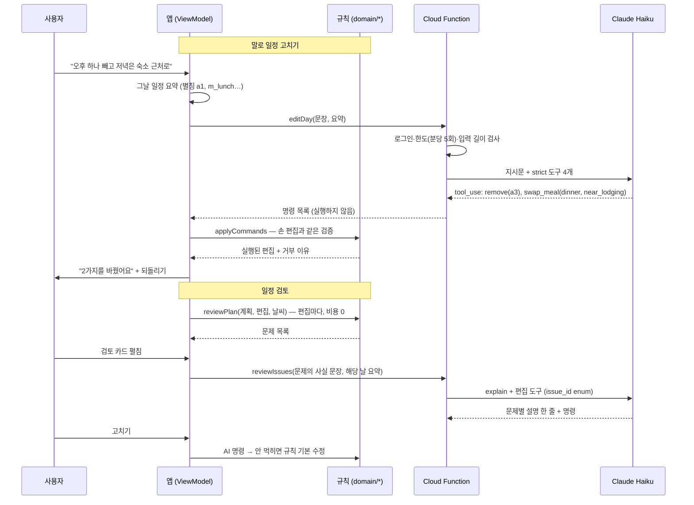

# 규칙 엔진 + LLM 도구 호출 파이프라인

Readytogo에서 LLM(Claude Haiku)은 **결정을 내리지 않는다.** 결정은 규칙(Kotlin 코드)이 하고, LLM은 사람 말과 규칙 사이를 잇는 두 가지 일만 한다.

1. **말로 일정 고치기** — 사용자 문장을 편집 명령으로 번역
2. **일정 검토** — 규칙이 찾은 문제를 설명하고 고칠 명령을 제안

## 전체 흐름

## 설계 원칙

### LLM은 "기준"만 고른다

도구는 장소를 받지 않는다. `swap_meal(meal, basis)`의 basis는 `near_lodging` / `near_prev` / `cheaper` / `exclude_same_kind` 중 하나이고, 그 기준에 맞는 후보 중 **점수가 가장 높은 곳**을 앱이 고른다. 모델이 식당을 직접 고르면 점수 규칙을 우회하고 없는 가게를 지어낼 수 있다.

| 도구 | 인자 | 비고 |
|---|---|---|
| `remove` | id | 관광지만. 끼니는 하루의 뼈대라 뺄 수 없다 |
| `move` | id, after_id | 같은 날 안에서만. 첫 끼니 앞으로는 못 간다 |
| `swap_meal` | meal, basis | 식당은 점수가 고른다 |
| `swap_place` | id, basis(`indoor` / `near_prev`) | 관광지는 가격이 없어 `cheaper`가 없다 |
| `explain` | issue_id, why | 검토에서만. 문제마다 한 번 |

### 틀려도 해가 없게

- **strict 스키마 + enum**: 목록 밖의 값이나 빠진 필드를 보낼 수 없다. 검토의 `issue_id`는 그 요청의 문제 id만 enum으로 허용한다.
- **짧은 별칭**: Google 장소 id 대신 `a1`, `m_lunch`. 토큰이 적고, 옮겨 적다 틀리면 엉뚱한 곳이 아니라 "없는 항목"이 된다.
- **같은 실행 경로**: 모델 명령은 손 편집과 같은 `applyCommands`를 지난다. 하나씩 실행하며 매번 타임라인을 다시 만들어, 뒤 명령이 앞 명령이 바뀐 화면을 기준으로 해석된다. 실행 못 한 명령은 이유(`없는 항목`, `끼니는 고정`, `근처에 실내 없음`…)와 함께 스낵바로 알린다.
- **되돌리기 한 번**: 명령이 여러 개여도 저장도 되돌리기도 한 번이다.
- **명령 0개**: 일정과 무관한 문장이면 도구를 부르지 않게 지시한다 → "무엇을 바꿀지 이해하지 못했어요".

### 문제 찾기는 규칙이

검토 규칙 4개(`domain/review/PlanReview.kt`)는 편집할 때마다 다시 돈다. AI는 카드를 펼칠 때 **답이 없는 문제만** 한 번 묻는다. 같은 문제(데이터 클래스 동등성)는 다시 묻지 않으므로, 하나를 고친 뒤 남은 문제로 호출이 또 나가지 않는다.

| 규칙 | 판정 | 기본 수정 |
|---|---|---|
| 하루가 김 | 체류 + 이동 > 이번 일정의 "프로필대로 꽉 찬 날" 최대치 (새 상수 없음 — 처음 만든 일정엔 안 걸리고 편집으로 길어질 때만) | 빼면 가장 짧아지는 관광지 빼기 |
| 같은 종류 연속 | 점심·저녁을 날짜를 넘어 잇고 Places `primaryType`이 같은 묶음 (범용 타입·아침 제외). 묶음 하나가 한 건 | 다른 종류로 바꾸기 |
| 방문일 휴무 | Places 정기 영업시간을 알 때만 | 관광지: 근처 교체 → 실내 교체 → 빼기 / 식당: 연 곳으로 |
| 비 오는 날 실외 | 강수확률 60% 이상(D-7 안) + 실외 관광지 | 실내로 교체 (그날 중심 5km 안에서만) |

모델에게는 **규칙이 쓴 사실 문장**(예: "4일차 강수확률이 94%인데 실외 관광지가 있어요: 나카지마 공원.")과 그날 일정만 보낸다. 지시문에 "목록에 없는 사실을 지어내지 말 것"을 넣고, 화면에서도 사실 문장을 제목으로, AI 설명은 보조 줄로 보여준다.

AI가 없거나 실패해도 동작한다: 둘러보기 사용자는 함수를 부르지 않고, "고치기"는 규칙의 기본 수정으로 실행한다.

## 서버 (Cloud Functions)

- `functions/src/editDay.ts`, `reviewIssues.ts`, `tools.ts` — 검토 도구는 편집 도구 정의(`TOOLS`)에 `issue_id`만 덧붙여 만든다. 정의를 두 벌 두면 한쪽만 고쳐진다.
- 리전 asia-northeast3, maxInstances 2, 사고(thinking) 끔, `max_tokens` 512/1024를 비용 상한으로.
- 사용자당 분당 5회 (Firestore `rateLimits/{uid}`, 트랜잭션으로 셈). 형식이 틀린 요청은 모델을 부르기 전에 거절하고 한도도 쓰지 않는다.
- 문장은 로그에 남기지 않는다. 토큰 수만 남겨 비용을 추적한다.

## 앱 코드 위치

| 역할 | 파일 |
|---|---|
| 명령 정의·해석 | `domain/edit/EditCommand.kt` |
| 하루 요약(별칭) | `domain/edit/DaySummary.kt` |
| 검증·실행 | `domain/edit/ApplyCommands.kt` |
| 식당·관광지 교체 선택 | `domain/edit/MealSwap.kt`, `PlaceSwap.kt` |
| 검토 규칙·기본 수정 | `domain/review/PlanReview.kt`, `ReviewFixes.kt` |
| 함수 호출 | `data/repository/firebase/FunctionsDayEditAssistant.kt`, `FunctionsPlanReviewer.kt` |

테스트(AI 호출 없음): `ApplyCommandsTest`, `MealSwapTest`, `PlaceSwapTest`, `ParseCommandsTest`, `PlanReviewTest`, `ParseReviewTest`.
